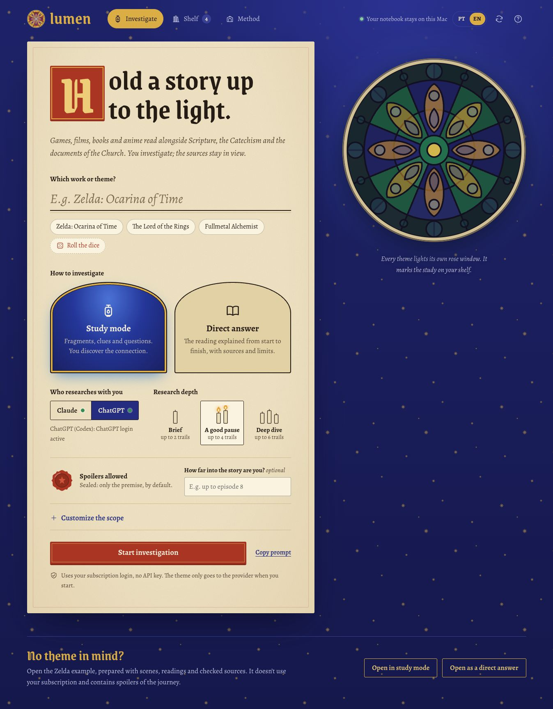

# Lumen

[Português](README.md) · [English](README.en.md)

An open-source Catholic study notebook for exploring games, films, books, manga and anime. Start with a work such as *The Legend of Zelda: Ocarina of Time*, read Scripture, the Catechism and Church documents, and build your own interpretation.



The interface is available in **Brazilian Portuguese and English**, using the **PT | EN** selector in the header. New research and discussion requests use the selected language; existing studies retain their original wording. Prepared Zelda examples are included in both languages. Tested on macOS; other operating systems have not been validated.

## Two ways to explore

- **Study mode:** Catholic texts and narrative fragments appear independently. Choose a passage and a scene, connect them with a red thread, write your hypothesis and discuss it. There is no hidden answer key.
- **Direct-answer mode:** receive a complete proposed reading, including narrative evidence, Catholic teaching, references and the limits of each analogy.

The AI can choose the structure of each step: reading cards, questions, timelines, interviews and interactive activities. Each work gets a generated stained-glass rose, and each saved investigation becomes a volume on your bookshelf. Marginal notes and connections are saved locally.

The tool distinguishes a documented historical influence, a possible Christian symbolism and an interpretation proposed by the reader. It does not assume that Nintendo or another creator intended a Catholic message.

## Run locally

You need:

- [Node.js 22 or newer](https://nodejs.org/) and Git.
- At least one installed CLI with a supported subscription login: [Claude Code](https://code.claude.com/docs/en/quickstart) or [Codex CLI](https://developers.openai.com/codex/cli/).

```sh
git clone https://github.com/DiogoSabec/lumen.git
cd lumen
npm start
```

Open **http://127.0.0.1:4318**. There are no npm packages to install.

Sign in to the provider you want to use, following that provider's CLI setup:

```sh
claude auth login
# or
codex login
```

The prepared Zelda examples work without a model login. Generating new studies and continuing discussions require an authenticated provider and internet access. Your plan's eligibility, usage limits and availability apply. Lumen does not switch providers automatically or bypass usage limits.

### Optional macOS launcher

```sh
node scripts/create-mac-app.mjs
```

This creates **Abrir Lumen.app** for your machine. Double-click it to start the server in the background and open your browser. The generated launcher is not committed to the repository. Recreate it if you move the folder or change your Node installation.

To stop a server started by that launcher:

```sh
node scripts/stop.mjs
```

## Local notebook, online models

Lumen binds to `127.0.0.1`. Studies, conversation history, notes and downloaded images stay in `.data/` on your computer. Those files, logs, browser-tool caches, environment files and generated launchers are excluded from Git.

**This is not an offline language model.** The selected CLI sends your theme, supplied excerpts and study conversation to Claude or OpenAI. Source checks and image retrieval also access the internet. The prepared example can be read offline while the local server is running.

Lumen uses the CLIs' own subscription login, with no API key required by the app. Claude is restricted to web search and web fetching; Codex uses a read-only sandbox with shell execution disabled. Generated interactive pages run in an isolated document. A generated choice can prepare a draft; only the host's explicit submission starts another model request.

## Evidence and limitations

The research instructions request primary Catholic sources, exact locations and clear separation of facts, doctrine and interpretation. After generation, Lumen tries to open source URLs and locate short quoted passages. Quotes from the work that cannot be located are omitted from the display.

Source markers distinguish **text located**, **check the section** and **not confirmed**. Locating a string on a page does not establish the correctness of a paragraph reference, interpretation or theological application. Models can still make mistakes. Read the original sources and their context; the app is a research aid, not an ecclesiastical authority.

Prepared example images retain their credits and source pages. Images that cannot be retrieved are not displayed. Translations of game dialogue are labeled as free translations, not official localizations.

## Development

```sh
npm test
```

The local tests cover response contracts, study/direct separation, source checking, image handling, CLI arguments, credential environment handling and local-server persistence/restrictions. They do not automatically spend model quota or certify theological correctness.

The full Portuguese guide is in [README.md](README.md). Provider integration references: [Codex non-interactive mode](https://learn.chatgpt.com/docs/non-interactive-mode) and [Claude Code programmatic usage](https://code.claude.com/docs/en/headless).

## License

Lumen's original code is available under the [MIT license](LICENSE). Third-party fonts, Nintendo artwork and screenshots, quotations and source documents retain their own rights and terms; see [THIRD_PARTY.md](THIRD_PARTY.md). Independent project, with no official affiliation with the Church, Nintendo, OpenAI or Anthropic.

Feedback, reference corrections and code contributions are welcome. Please do not include credentials, private notes or your complete `.data` folder in public issues.
