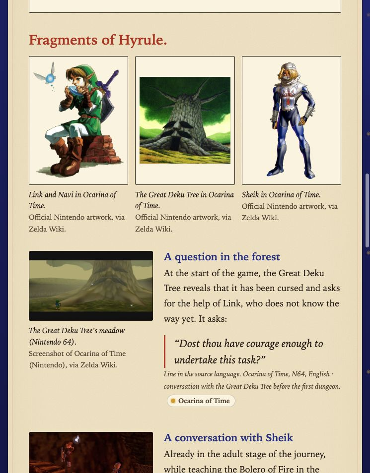
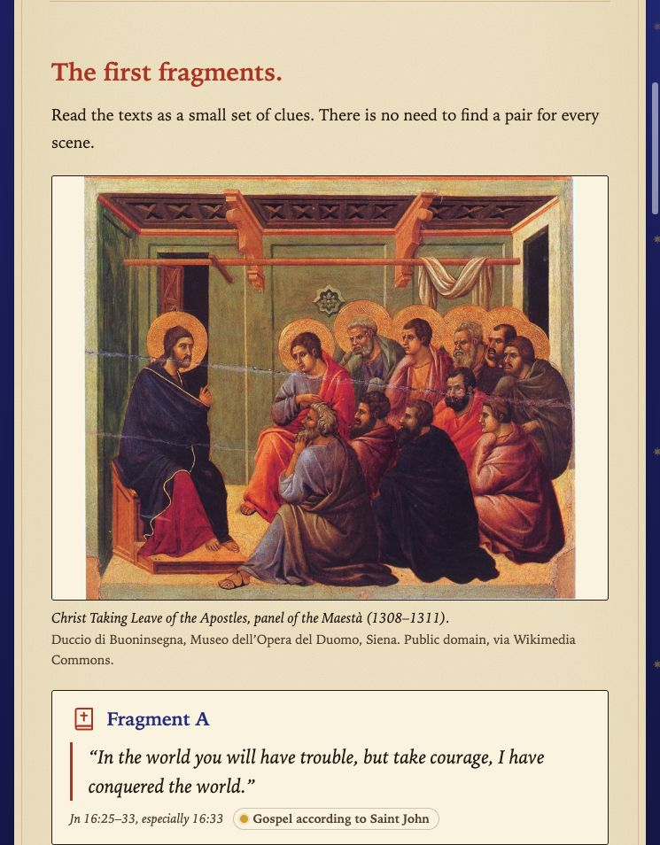
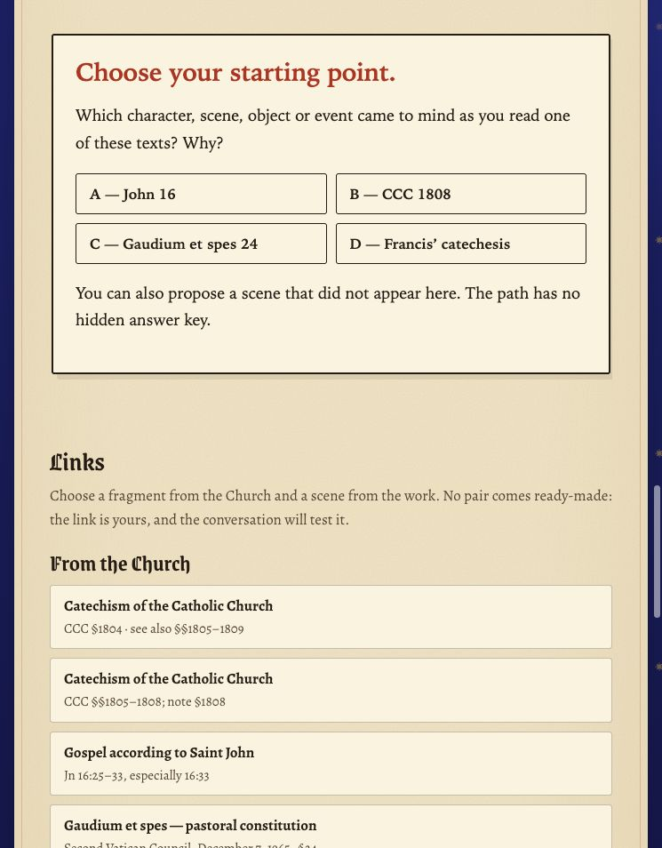
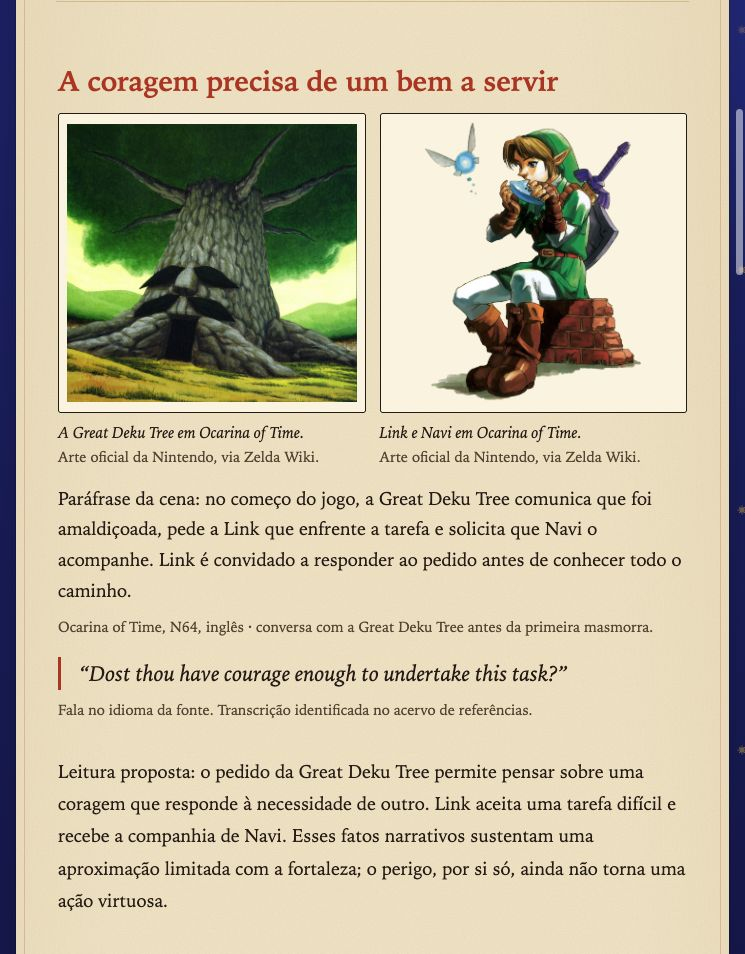
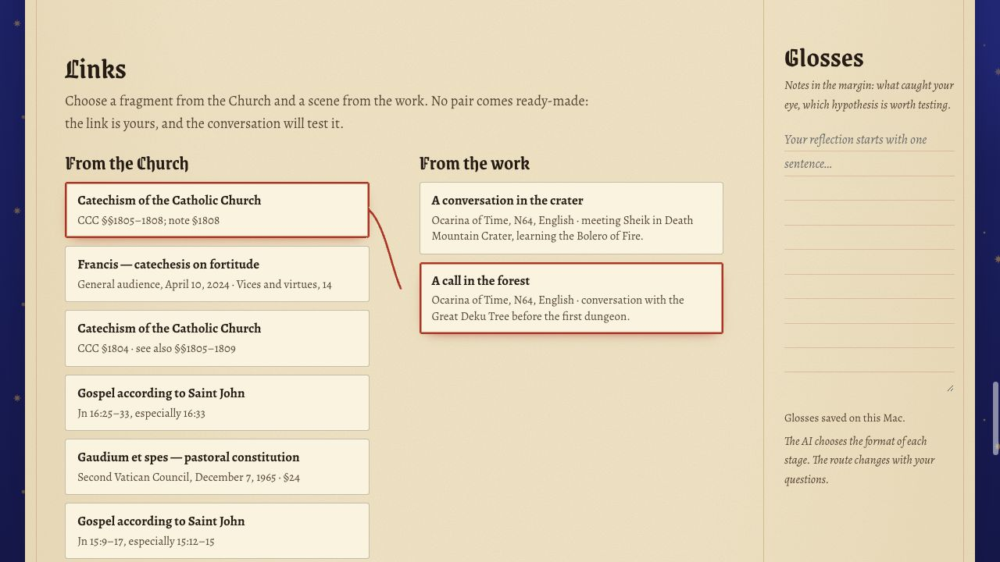

# Lumen

[Português](README.md) · [English](README.en.md)

**Hold a story up to the light.**

A Catholic study notebook for exploring games, films, series, books, manga and anime alongside Scripture, the Catechism and Church documents. Choose a work; Lumen gathers research material and follows your questions.

**Free and open source · Portuguese and English · Local notebook · Claude and ChatGPT**

[Get started](#get-started) · [Screenshots](#screenshots) · [How it works](#an-investigation-in-five-steps) · [Sources and limitations](#sources-and-limitations)

## Two ways to study

| | Study mode | Direct answer |
| --- | --- | --- |
| **You receive** | Passages, references, scenes and questions, without revealing the parallels immediately. | A complete proposed reading, with narrative evidence, Catholic teaching, references and limits. |
| **You take part** | Choose a clue, suggest a connection and test your hypothesis through discussion. | Read the explanation, then question or explore whatever catches your attention. |
| **The experience develops** | The AI can introduce choices, interviews, challenges and further clues. | The AI can arrange comparisons, reading paths and other interactive presentations. |

The purpose is to encourage reading the sources. There is no hidden answer key, requirement to connect every detail or score for your faith. A reader's analogy does not establish the creators' religious intent.

## Screenshots

Actual captures of the prepared *The Legend of Zelda: Ocarina of Time* example. The scenes include spoilers. New studies may look different because the AI chooses each stage's presentation.

<table>
  <tr>
    <td width="50%" valign="top">
      <strong>Scenes and dialogue from the work</strong><br><br>
      
    </td>
    <td width="50%" valign="top">
      <strong>Sacred art and Scripture</strong><br><br>
      
    </td>
  </tr>
  <tr>
    <td width="50%" valign="top">
      <strong>A clue to start with</strong><br><br>
      
    </td>
    <td width="50%" valign="top">
      <strong>Direct answer example · Portuguese</strong><br><br>
      
    </td>
  </tr>
</table>

<details>
<summary>See the home screen and connections board</summary>

### Choose the work, mode and research depth


### Build a hypothesis and keep marginal notes



</details>

[Full gallery: 11 screenshots in PT/EN and four rose windows in SVG](docs/screenshots/gallery/README.md). Third-party artwork retains its credits and rights; see [THIRD_PARTY.md](THIRD_PARTY.md).

## Get started

You need [Node.js 22 or newer](https://nodejs.org/) and Git. Tested on **macOS**; other operating systems have not been validated.

```sh
git clone https://github.com/DiogoSabec/lumen.git
cd lumen
npm start
```

Open **http://127.0.0.1:4318** in your browser. There are no npm packages to install.

**Try it first:** open the Zelda example in study or direct-answer mode from the home screen. It includes prepared texts, sources and images, requires no AI login and uses no subscription quota. Continuing the discussion with AI requires an authenticated provider.

### Connect Claude or ChatGPT

To generate new research, install at least one CLI and sign in with your subscription:

| Provider in Lumen | Installation and access | Login command |
| --- | --- | --- |
| **ChatGPT** | [Codex CLI](https://developers.openai.com/codex/cli/) with ChatGPT login | `codex login` |
| **Claude** | [Claude Code](https://code.claude.com/docs/en/quickstart) with Claude login | `claude auth login` |

Lumen uses the CLI's own login, with no API key. Your subscription must include access to the chosen CLI, and the plan's limits and terms still apply. The project is free; model access depends on your plan. Lumen does not switch providers automatically.

### Open without a terminal on macOS

Run this once from the project folder:

```sh
node scripts/create-mac-app.mjs
```

Then double-click **Abrir Lumen.app** in Finder. It starts the server in the background and opens your browser; research also runs without a terminal window. Recreate the launcher if you move the folder or change your Node installation. It is generated for your computer and is not included as a ready-made app in the repository.

To stop a server started by the launcher:

```sh
node scripts/stop.mjs
```

If you started with `npm start`, press **Ctrl+C** in that terminal instead.

## An investigation in five steps

1. **Choose a work or theme.** Start with Zelda, a film, series, book, manga or anime. Use **Roll the dice** to find a starting point.
2. **Set the scope.** Specify an edition, character, topic and how far into the story you are. Spoilers are limited to the premise by default.
3. **Choose how to study.** Select the mode, provider and research depth: brief, a good pause or deep dive.
4. **Read and discuss.** Open the references, form a hypothesis and ask for a clue or a deeper reading. In study mode, connect a Church fragment with a scene and explain your reasoning.
5. **Keep your progress.** Return through the **Shelf**, write your **Glosses** and export the study as Markdown or JSON.

The **PT | EN** selector changes the interface and the language requested for new research and discussion turns. Saved studies retain their original wording. Literal quotations remain in the source language; free translations are labeled. The Zelda example is available in both languages.

## An interface that follows the discovery

- **Flexible presentation:** the AI composes each stage with text, images, questions, cards, choices, timelines and other interactions. The Zelda example shows one possible presentation.
- **Connections:** the lists of fragments and scenes are shuffled to avoid suggesting ready-made pairs. Choose a connection, save your reasoning or take it into the discussion. In the wide layout, a red thread joins your choices.
- **Rose windows:** each theme generates its own stained-glass design. Mode changes the colors and research depth changes the number of petals; the rose also identifies the volume on your shelf.
- **Glosses and shelf:** notes, connections and history stay in your local notebook to revisit later.
- **Images with attribution:** characters, places, screenshots and sacred art can accompany the readings. Each image keeps its credit and source page; failed downloads are recorded in the archive.

Generated interactive pages run in isolation. A choice can prepare a draft message; only explicit submission in the host panel starts another provider request.

## Sources and limitations

Research instructions ask the AI to separate **facts from the work**, **Catholic teaching** and **interpretations proposed by the reader**. A documented historical influence, possible Christian symbolism and a personal analogy are different claims.

Sources may include Catholic editions of the Bible, the Catechism, official Church documents, writings of saints and material from the work itself. Saints' writings should identify the work and location, distinguishing spiritual or theological writing from magisterial documents. The AI may ask for clarification or return less material when identification or evidence is insufficient.

After research, the server tries to open the links and locate the short quoted passages:

| Marker | What it tells you |
| --- | --- |
| **Text located** | The passage was found on the consulted page or in material checked while preparing the example. |
| **Check section** | The page responded, but the exact passage was not located or there was no literal quote to compare. |
| **To be checked** | Access was blocked, the format was unsupported, the request timed out or evidence was insufficient. |

**Finding a sentence does not certify the interpretation, exact paragraph reference or theological application.** Lines from the work that cannot be located are omitted from the presentation. Read sources in context: models can make mistakes and propose weak analogies, and Lumen is not an ecclesiastical authority.

The Zelda example identifies its third-party dialogue transcript and recommends comparison with the game. Its excerpts were prepared on **October 27, 2026**; opening the example does not perform a fresh online check.

## What stays local

The server listens only on `127.0.0.1`. Your notebook is saved on your computer:

| Folder | Contents |
| --- | --- |
| `.data/studies/` | Studies, stages, conversation, connections, glosses and interaction state in JSON. |
| `.data/media/` | Local copies of study images. |
| `examples/media/` | Images bundled with the prepared Zelda example. |
| `.runtime/` | Server logs and working files. |

**Local refers to the app and notebook. The models are online.** Your theme, supplied excerpts and conversation context are sent to the chosen provider. Source checks and image searches also use the internet. The prepared example can be read offline while the local server is running.

The app includes no analytics and does not publish your studies to a public service. Private notebook data, caches, environment files and generated launchers are excluded from Git. To back up your notebook, copy `.data/studies/`; each study can also be exported as **Markdown** (text, sources and notes) or **JSON** (including presentation and history).

## Development

A Node.js application with no npm runtime dependencies, using HTML, CSS and JavaScript for the interface.

```sh
npm test
```

The local suite covers response contracts, mode separation, sources, images, CLI arguments, credential environment handling, persistence and server restrictions. It does not call real models or spend subscription quota automatically, and it does not certify theological correctness.

<details>
<summary>Structure, configuration and provider integration</summary>

| Path | Responsibility |
| --- | --- |
| `server.mjs` | Local server, studies, research and presentations. |
| `lib/` | Data contracts, prompts, providers, sources and images. |
| `public/` | Interface, translations, rose windows, fonts and renderer. |
| `prompts/sistema.md` | Research, evidence, modes and presentation instructions. |
| `examples/` | Prepared Zelda examples in PT/EN, in both modes. |
| `scripts/` | macOS launching and example preparation. |
| `tests/` | Local tests without model calls. |

Optional environment variables:

- `LUMEN_PORT`: server port; defaults to `4318`.
- `LUMEN_DATA_DIR`: studies folder; defaults to `.data/studies/`.
- `LUMEN_MEDIA_DIR`: image folder; defaults to `.data/media/`, or `media/` inside `LUMEN_DATA_DIR` when set.

Codex uses web search and a read-only sandbox with shell execution disabled. Claude receives only WebSearch and WebFetch, with MCPs, skill commands and hooks disabled for these runs. The app removes API-key environment variables from provider processes and checks the login type before each research request.

References: [Codex CLI](https://developers.openai.com/codex/cli/) and [Claude Code programmatic usage](https://code.claude.com/docs/en/headless).

</details>

## Contribute and reuse

Reference corrections, bug reports and code contributions are welcome through [issues](https://github.com/DiogoSabec/lumen/issues) and pull requests. When reporting a problem, include your operating system, provider and reproduction steps, without credentials or private glosses.

Original code is distributed under the [MIT license](LICENSE). Third-party fonts, Nintendo artwork, screenshots and quoted texts retain their own terms; see the [third-party credits](THIRD_PARTY.md).

Independent project, with no official affiliation with the Church, Nintendo, OpenAI or Anthropic.
