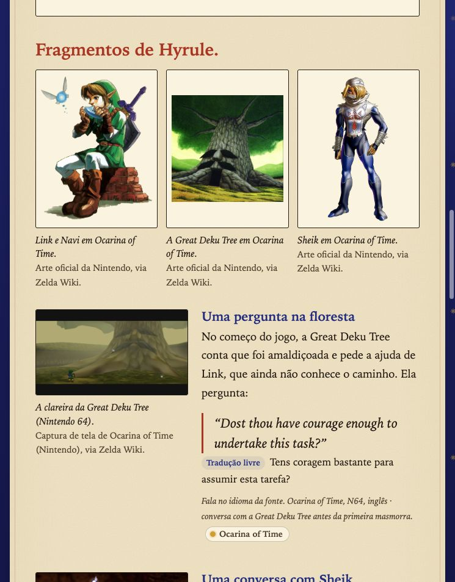
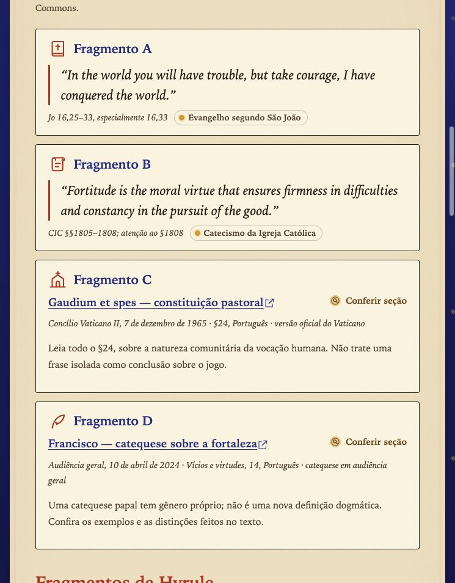
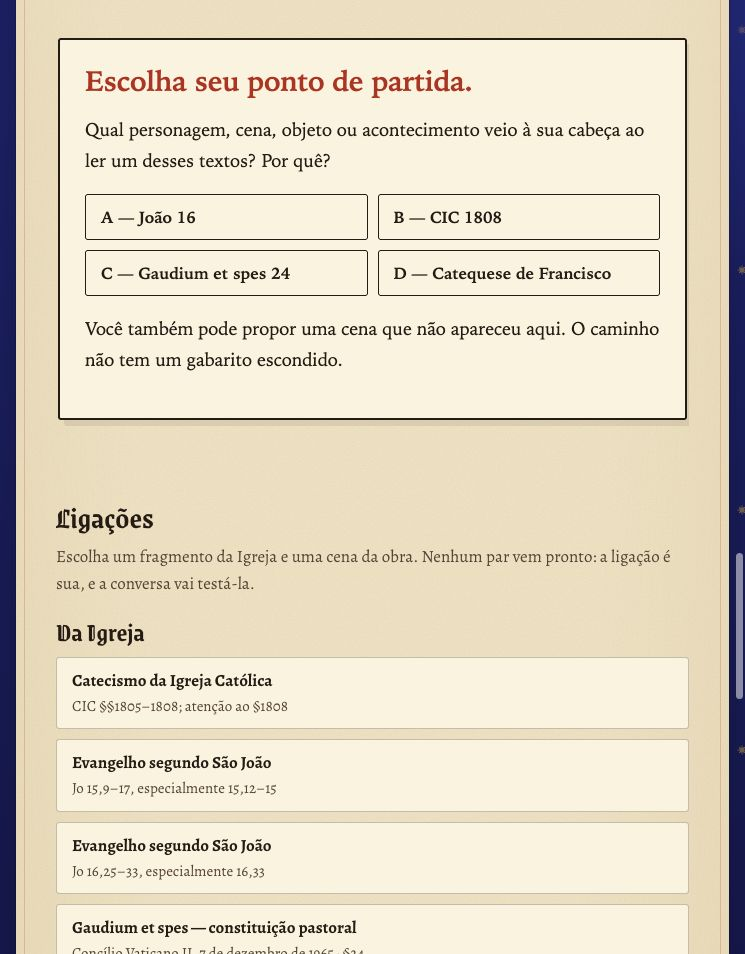
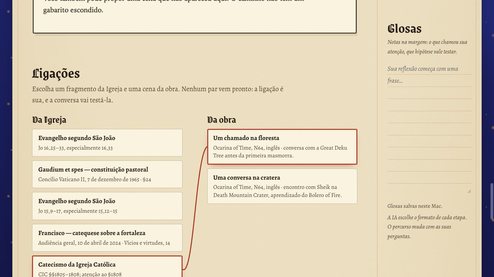

# Lumen

[Português](README.md) · [English](README.en.md)

**Ponha uma história contra a luz.**

Um caderno de investigação católica para explorar jogos, filmes, séries, livros, mangás e animes ao lado da Escritura, do Catecismo e dos documentos da Igreja. Você escolhe uma obra; o Lumen reúne material de pesquisa e acompanha suas perguntas.

**Gratuito e de código aberto · Português e inglês · Caderno local · Claude e ChatGPT**

[Começar](#começar) · [Screenshots](#screenshots) · [Como funciona](#uma-investigação-em-cinco-passos) · [Fontes e limites](#fontes-e-limites)

## Dois modos de estudar

| | Modo estudo | Resposta direta |
| --- | --- | --- |
| **Você recebe** | Passagens, referências, cenas e perguntas, sem entregar os paralelos de imediato. | A leitura completa, com evidência da obra, ensinamento católico, referências e limites. |
| **Você participa** | Escolhe uma pista, propõe uma ligação e testa sua hipótese na conversa. | Lê a explicação e pergunta, questiona ou aprofunda o que chamou sua atenção. |
| **A experiência evolui** | A IA pode propor escolhas, entrevistas, desafios e novas pistas. | A IA pode organizar comparações, percursos de leitura e outras apresentações interativas. |

O objetivo é estimular a leitura das fontes. Não há gabarito escondido, obrigação de encontrar uma conexão para tudo ou pontuação de fé. Uma analogia do leitor não demonstra intenção religiosa dos criadores da obra.

## Screenshots

Capturas reais do exemplo preparado de *The Legend of Zelda: Ocarina of Time*. As cenas incluem spoilers; novas pesquisas podem ter outra apresentação, pois a IA escolhe o formato de cada etapa.

<table>
  <tr>
    <td width="50%" valign="top">
      <strong>Cenas e diálogos da obra</strong><br><br>
      
    </td>
    <td width="50%" valign="top">
      <strong>Escritura, Catecismo e documentos</strong><br><br>
      
    </td>
  </tr>
  <tr>
    <td width="50%" valign="top">
      <strong>Uma pista para começar</strong><br><br>
      
    </td>
    <td width="50%" valign="top">
      <strong>O modo resposta direta</strong><br><br>
      
    </td>
  </tr>
</table>

<details>
<summary>Ver a tela inicial e o quadro de ligações</summary>

### Escolha a obra, o modo e o fôlego da pesquisa


### Construa uma hipótese e registre suas glosas



</details>

[Galeria completa: 11 prints em PT/EN e quatro rosáceas em SVG](docs/screenshots/gallery/README.md). As artes de terceiros mantêm seus créditos e direitos; veja [THIRD_PARTY.md](THIRD_PARTY.md).

## Começar

Você precisa de [Node.js 22 ou superior](https://nodejs.org/) e Git. Testado no **macOS**; outros sistemas ainda não foram validados.

```sh
git clone https://github.com/DiogoSabec/lumen.git
cd lumen
npm start
```

Abra **http://127.0.0.1:4318** no navegador. Não há dependências npm para instalar.

**Experimente primeiro:** na tela inicial, abra o exemplo de Zelda em modo estudo ou resposta direta. Ele inclui textos, fontes e imagens preparados, funciona sem login de IA e não consome sua assinatura. Continuar a conversa com a IA exige um provedor autenticado.

### Conectar Claude ou ChatGPT

Para gerar novas pesquisas, instale pelo menos um dos CLIs e entre com sua assinatura:

| Provedor no painel | Instalação e acesso | Comando de login |
| --- | --- | --- |
| **ChatGPT** | [Codex CLI](https://developers.openai.com/codex/cli/) com login do ChatGPT | `codex login` |
| **Claude** | [Claude Code](https://code.claude.com/docs/en/quickstart) com login do Claude | `claude auth login` |

O Lumen usa o login do próprio CLI, sem chave de API. Sua assinatura precisa incluir acesso ao CLI escolhido, e os limites e condições do plano continuam valendo. O projeto é gratuito; o acesso aos modelos depende do seu plano. Não há troca automática de provedor.

### Abrir sem terminal no macOS

Na pasta do projeto, execute uma vez:

```sh
node scripts/create-mac-app.mjs
```

Depois, dê dois cliques em **Abrir Lumen.app** no Finder. O servidor inicia em segundo plano e abre o navegador; as pesquisas também rodam sem janela de terminal. Recrie o atalho se mover a pasta ou mudar a instalação do Node. O atalho é gerado para o seu computador e não vem pronto no repositório.

Para encerrar o servidor iniciado pelo atalho:

```sh
node scripts/stop.mjs
```

Se iniciou com `npm start`, encerre com **Ctrl+C** naquele terminal.

## Uma investigação em cinco passos

1. **Escolha uma obra ou tema.** Pode ser Zelda, um filme, uma série, um livro, um mangá ou um anime. Use **Tirar a sorte** para descobrir um ponto de partida.
2. **Defina o recorte.** Informe edição, personagem, assunto e até onde conhece a história. Os spoilers ficam restritos à premissa por padrão.
3. **Escolha como estudar.** Selecione o modo, o provedor e o fôlego: breve, uma boa pausa ou mergulho.
4. **Leia e converse.** Abra as referências, formule uma hipótese e peça uma pista ou um aprofundamento. No modo estudo, ligue um fragmento da Igreja a uma cena e justifique sua leitura.
5. **Guarde o percurso.** Continue pela **Estante**, escreva suas **Glosas** e exporte o estudo em Markdown ou JSON.

O seletor **PT | EN** troca o idioma da interface e das próximas pesquisas e conversas. Estudos salvos mantêm a redação original. Citações literais permanecem no idioma da fonte; traduções livres são identificadas. O exemplo de Zelda está disponível nos dois idiomas.

## Uma interface que acompanha a descoberta

- **Apresentação livre:** a IA compõe cada etapa com textos, imagens, perguntas, cartões, escolhas, linhas do tempo e outras interações. O exemplo de Zelda é uma possibilidade de apresentação.
- **Ligações:** as listas de fragmentos e cenas são embaralhadas para não sugerir pares prontos. Você escolhe uma ligação, guarda uma justificativa ou a leva para a conversa. Na visualização ampla, um fio vermelho une as escolhas.
- **Rosáceas:** cada tema gera um vitral próprio. O modo altera as cores e o fôlego altera o número de pétalas; a rosácea também identifica o volume na estante.
- **Glosas e estante:** anotações, ligações e histórico ficam no caderno local para retomar depois.
- **Imagens com origem:** personagens, lugares, capturas e arte sacra podem acompanhar as leituras. Cada imagem mantém crédito e página de origem; arquivos que não puderem ser obtidos ficam indicados no acervo.

As páginas interativas geradas rodam isoladamente. Uma escolha pode preparar uma mensagem; somente o envio explícito no painel inicia outro pedido ao provedor.

## Fontes e limites

As instruções de pesquisa pedem que a IA separe **fatos da obra**, **ensinamentos católicos** e **interpretações propostas pelo leitor**. Influência histórica documentada, simbolismo cristão possível e analogia pessoal são afirmações diferentes.

As fontes podem incluir Bíblia em edição católica, Catecismo, documentos oficiais da Igreja, escritos de santos e material da própria obra. Textos de santos devem trazer obra e localização, distinguindo escritos espirituais ou teológicos de documentos do Magistério. A IA pode pedir esclarecimentos ou trazer menos material quando a identificação ou a evidência forem insuficientes.

Depois de uma pesquisa, o servidor tenta abrir os links e localizar os pequenos trechos citados:

| Selo | O que informa |
| --- | --- |
| **Texto localizado** | O trecho foi encontrado na página consultada ou no material conferido na preparação do exemplo. |
| **Conferir seção** | A página respondeu, mas o trecho exato não foi localizado ou não havia citação literal para comparar. |
| **A conferir** | O acesso foi bloqueado, o formato não era suportado, o tempo esgotou ou faltou evidência. |

**Localizar uma frase não certifica a interpretação, a referência exata do parágrafo ou a aplicação teológica.** Falas da obra não localizadas são omitidas da apresentação. Leia as fontes em contexto: os modelos podem cometer erros e propor analogias fracas, e o Lumen não é uma autoridade eclesiástica.

O exemplo de Zelda identifica a transcrição de terceiros e recomenda compará-la com o jogo. Seus trechos foram preparados em **27/10/2026**; abrir o exemplo não faz nova conferência online.

## O que fica local

O servidor escuta apenas em `127.0.0.1`. O caderno é salvo no seu computador:

| Pasta | Conteúdo |
| --- | --- |
| `.data/studies/` | Estudos, etapas, conversa, ligações, glosas e estado das interações em JSON. |
| `.data/media/` | Cópias locais das imagens dos estudos. |
| `examples/media/` | Imagens incluídas no exemplo preparado de Zelda. |
| `.runtime/` | Logs e arquivos de trabalho do servidor. |

**Local se refere ao aplicativo e ao caderno. Os modelos são online.** O tema, os trechos fornecidos e o contexto da conversa são enviados ao provedor escolhido. Consultas de fontes e buscas de imagens também usam internet. O exemplo preparado pode ser lido offline com o servidor local ativo.

O aplicativo não inclui analytics nem publica seus estudos em um serviço público. Dados pessoais do caderno, caches, arquivos de ambiente e atalhos gerados ficam fora do Git. Para fazer backup, copie `.data/studies/`; cada estudo também pode ser exportado em **Markdown** (texto, fontes e notas) ou **JSON** (inclui apresentação e histórico).

## Desenvolvimento

Aplicativo em Node.js, sem dependências npm de execução, com interface em HTML, CSS e JavaScript.

```sh
npm test
```

A suíte local cobre contratos de resposta, separação dos modos, fontes, imagens, argumentos dos CLIs, credenciais no ambiente e persistência e restrições do servidor. Ela não chama modelos reais nem consome a assinatura automaticamente; tampouco certifica correção teológica.

<details>
<summary>Estrutura, configuração e integração com os provedores</summary>

| Caminho | Responsabilidade |
| --- | --- |
| `server.mjs` | Servidor local, estudos, pesquisas e apresentações. |
| `lib/` | Contratos de dados, prompts, provedores, fontes e imagens. |
| `public/` | Interface, traduções, rosáceas, fontes e renderizador. |
| `prompts/sistema.md` | Instruções de pesquisa, evidência, modos e liberdade de apresentação. |
| `examples/` | Exemplos preparados de Zelda em PT/EN, nos dois modos. |
| `scripts/` | Abertura no macOS e preparação dos exemplos. |
| `tests/` | Testes locais sem chamadas aos modelos. |

Configurações opcionais por variável de ambiente:

- `LUMEN_PORT`: porta do servidor; padrão `4318`.
- `LUMEN_DATA_DIR`: pasta dos estudos; padrão `.data/studies/`.
- `LUMEN_MEDIA_DIR`: pasta de imagens; padrão `.data/media/`, ou `media/` dentro de `LUMEN_DATA_DIR` quando definido.

O Codex usa pesquisa web e sandbox de leitura, com shell desabilitado. O Claude recebe apenas WebSearch e WebFetch, com MCPs, comandos de skills e hooks desabilitados nessas execuções. O aplicativo remove variáveis de chaves de API dos processos e verifica o tipo de login antes de cada pesquisa.

Referências: [Codex CLI](https://developers.openai.com/codex/cli/) e [uso programático do Claude Code](https://code.claude.com/docs/en/headless).

</details>

## Contribuir e reutilizar

Correções de referências, relatos de problemas e contribuições de código são bem-vindos nas [issues](https://github.com/DiogoSabec/lumen/issues) e nos pull requests. Para relatar um problema, informe o sistema, o provedor e os passos para reproduzir, sem incluir credenciais ou glosas pessoais.

O código original é distribuído sob [licença MIT](LICENSE). Fontes tipográficas, imagens da Nintendo, capturas de tela e textos citados mantêm suas próprias condições; veja os [créditos de terceiros](THIRD_PARTY.md).

Projeto independente, sem vínculo oficial com a Igreja, Nintendo, OpenAI ou Anthropic.
