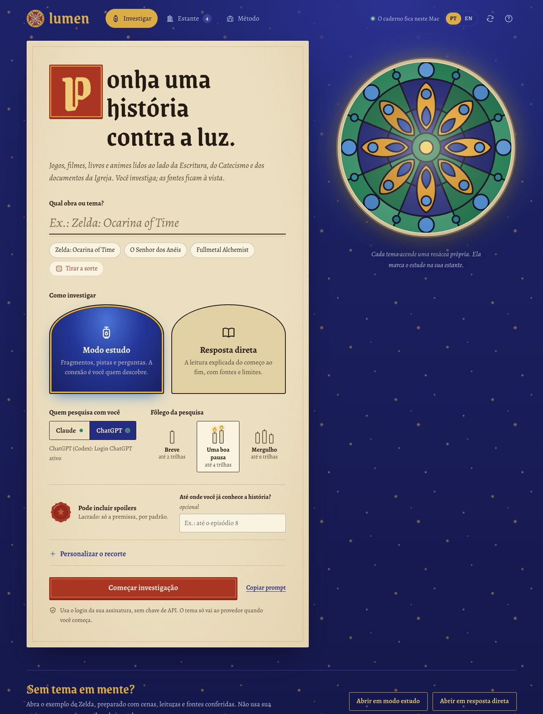

# Lumen

[Português](README.md) · [English](README.en.md)

Um caderno local para investigar obras e temas à luz da fé católica, com dois modos e uma conversa que evolui com suas perguntas.



**Código aberto sob licença MIT.** Aplicativo local em Node.js, testado no macOS, com interface em português e inglês. Usa Claude Code ou Codex CLI com o login da sua assinatura; os modelos continuam sendo serviços online.

## Instalar a partir do GitHub

Pré-requisitos: [Node.js 22+](https://nodejs.org/), Git e pelo menos um dos CLIs instalados e autenticados: [Claude Code](https://code.claude.com/docs/en/quickstart) ou [Codex CLI](https://developers.openai.com/codex/cli/). A assinatura precisa incluir acesso ao CLI escolhido; seus limites continuam valendo.

```sh
git clone https://github.com/DiogoSabec/lumen.git
cd lumen
npm start
```

Abra **http://127.0.0.1:4318** no navegador. Não há dependências npm para instalar. O exemplo de Zelda pode ser aberto sem um login de IA; gerar estudos e continuar conversas exige um provedor autenticado.

Para criar o atalho de abertura no macOS, execute uma vez na pasta do projeto:

```sh
node scripts/create-mac-app.mjs
```

O atalho é gerado para a sua instalação. Ele não é distribuído pronto no repositório.

## Abrir

No Finder, dê dois cliques em **Abrir Lumen.app** nesta pasta. O servidor inicia em segundo plano e abre o navegador em **http://127.0.0.1:4318**. As pesquisas também rodam em segundo plano, sem janela de terminal.

Também é possível iniciar com Node.js 22 ou superior:

```sh
npm start
```

Nenhum pacote npm precisa ser instalado. Para encerrar o servidor iniciado pelo atalho:

```sh
node scripts/stop.mjs
```

Se mover esta pasta ou mudar a instalação do Node, recrie o atalho:

```sh
node scripts/create-mac-app.mjs
```

## Usar

1. Informe a obra ou tema. Se quiser, escolha edição, personagem, recorte e limite de spoilers.
2. Escolha **Modo estudo** ou **Resposta direta**.
3. Escolha **Claude** ou **ChatGPT** e comece a investigação.
4. Leia as fontes, ligue fragmentos às cenas, escreva glosas e continue a conversa. Cada estudo vira um volume na **Estante**, salvo em disco.

### Idioma

O seletor **PT | EN** no cabeçalho troca a interface entre português e inglês, e a escolha fica salva neste navegador. Pesquisas e conversas iniciadas depois da troca pedem a resposta da IA no idioma escolhido; citações literais continuam no idioma da fonte, e em inglês a IA prefere edições católicas em inglês. Estudos já salvos mantêm o idioma em que foram escritos. O exemplo de Zelda tem versão em inglês (`examples/zelda-*.en.json`), gerada a partir dos arquivos em português por `node scripts/build-example-en.mjs`, com as mesmas fontes conferidas e imagens.

### A interface

- **Rosácea do tema:** cada obra gera um vitral próprio, sempre o mesmo para o mesmo tema. O modo muda as cores do vidro; o fôlego muda o número de pétalas. Ela aparece enquanto você digita, acende durante a pesquisa e marca a lombada do volume na estante.
- **Tirar a sorte:** sorteia uma obra (jogos, filmes, livros, séries, animes e mangás) para começar.
- **Ligações (modo estudo):** escolha um fragmento da Igreja e uma cena da obra; um fio vermelho liga os dois. As listas são embaralhadas para não sugerir pares prontos. Guarde a ligação com uma justificativa ou leve-a direto para a conversa. As ligações ficam salvas como texto e sobrevivem às etapas seguintes.
- **Glosas:** as anotações pessoais ficam na margem do fólio, como nos manuscritos.
- **Imagens:** a IA pode trazer personagens, lugares, mapas, itens e arte sacra, e decide onde e como mostrá-los (lado a lado, galeria, mapa grande). Ela indica a página onde a imagem aparece; o servidor baixa o arquivo, confere pelos próprios bytes que é PNG, JPEG, GIF ou WebP e guarda uma cópia local. Wikis da obra e o Wikimedia Commons respondem pela API do MediaWiki; nas demais páginas vale a imagem principal declarada (`og:image`). Imagens que não puderem ser baixadas (o Fandom costuma bloquear) simplesmente não aparecem e ficam listadas no acervo com o motivo. Crédito e página de origem acompanham cada imagem.
- **Peças para a IA montar a página:** selos de fonte dentro do texto (clicáveis, abrem o acervo na referência), citações que só aparecem se o trecho foi localizado, falas da obra no idioma original com tradução livre sempre rotulada, e um conjunto de ícones. Com elas a IA compõe livremente cartões com ícones, captura de tela ao lado da fala, comparações lado a lado e outros formatos.
- **Selos das fontes:** selo dourado para texto localizado, selo com lupa para conferir seção, selo tracejado para a conferir.

O exemplo de Zelda já está preparado nos dois modos e pode ser aberto sem chamar um modelo. Continuar a conversa sobre o exemplo usa o provedor que você selecionar.

### Modo estudo: uma investigação aberta

Fragmentos católicos e cenas da obra aparecem sem pares prontos. Você propõe uma hipótese; a próxima etapa pode examiná-la, pedir um detalhe, sugerir outra leitura ou abrir um novo desafio. Não há uma resposta única nem uma pontuação de fé.

A IA tem liberdade para criar a apresentação: cartas, escolhas, perguntas, entrevistas, linhas do tempo, pequenos desafios e outras interações. Ela decide o formato e a sequência a cada etapa. O aplicativo mantém o caderno, a conversa e as referências acessíveis. As interfaces geradas rodam isoladamente; só o painel principal inicia pedidos aos provedores.

### Resposta direta

Traz a explicação completa, com evidência da obra, referência católica, interpretação proposta e limites da comparação. Também pode ter apresentação interativa, sem exigir uma tentativa para receber a explicação.

## Assinaturas

- **ChatGPT:** Codex CLI, com login do ChatGPT. Não é uma automação da interface web do ChatGPT.
- **Claude:** Claude Code, com login da assinatura Claude.
- Não usa chaves de API. O aplicativo remove variáveis de chaves de API do ambiente dos processos e verifica o tipo de login antes de cada pesquisa.
- Os limites, a disponibilidade e as condições dos planos continuam valendo. Não há troca automática de provedor nem tentativas de contornar limites.

Depois de instalar o CLI escolhido, faça o login da sua assinatura. Caso o login expire, entre novamente e atualize o status no painel:

```sh
codex login
claude auth login
```

O Codex é executado com pesquisa web, sandbox de leitura e shell desabilitado. O Claude recebe apenas WebSearch e WebFetch; MCPs, comandos de skills e hooks são desabilitados para essas execuções. O modelo recebe o pedido e o contexto do estudo, sem ferramentas para editar seus arquivos.

## Fontes e honestidade

O sistema pede que a IA diferencie fatos da obra, ensinamentos católicos e interpretações do leitor. Referência histórica comprovada, simbolismo cristão possível e analogia pessoal são categorias distintas.

A IA deve consultar Bíblia em edição católica, Catecismo, documentos oficiais e fontes da própria obra. Textos de santos podem ser usados com obra e localização identificadas, distinguindo sua condição de escritos espirituais ou teológicos da de documentos do Magistério. Não é obrigatório encontrar um paralelo para cada detalhe.

Depois da resposta, o servidor tenta abrir as URLs e localizar os pequenos trechos citados. O painel distingue:

- **Texto localizado:** o trecho foi encontrado na página ou no conteúdo consultado na preparação do exemplo. Isso não certifica a interpretação nem a localização exata do trecho dentro de toda a página.
- **Conferir seção:** a página respondeu, mas o trecho exato não foi localizado ou não havia citação literal para comparar.
- **A conferir:** acesso bloqueado, formato não suportado, tempo esgotado ou ausência de evidência suficiente.

Falas da obra não localizadas são omitidas da apresentação. Citações verificadas são mantidas no idioma da fonte, com a edição identificada. O exemplo de Zelda usa transcrição de terceiros, explicitamente identificada, e recomenda comparar com o jogo. Os trechos foram preparados em 27/10/2026; abrir o exemplo não faz nova conferência online.

Os modelos continuam podendo cometer erros e propor analogias fracas. O aplicativo não garante correção doutrinal ou pertinência hermenêutica. A conferência textual é uma ajuda para pesquisar, não um substituto da leitura de contexto. Em obras desconhecidas ou ambíguas, a IA pode pedir uma identificação ou devolver menos material.

## Onde fica tudo

- `.data/studies/`: estudos, etapas, histórico da conversa, estado das interações, ligações e glosas em JSON.
- `.data/media/`: cópias locais das imagens usadas nos estudos. Pode ser apagada; as imagens voltam a ser baixadas na próxima etapa que as usar.
- `examples/media/`: imagens do exemplo de Zelda, para ele abrir sem internet.
- `.runtime/`: logs técnicos do servidor e arquivos temporários. O painel não copia credenciais de login.
- `prompts/sistema.md`: instruções comuns aos dois provedores, incluindo regras de evidência, modos e liberdade criativa.
- `examples/`: exemplo preparado de Zelda nos dois modos.
- `public/`: interface, gerador de rosáceas (`rose.js`), fontes locais e renderizador da experiência.
- `.firecrawl/`: cache utilizado na pesquisa de preparação; não é necessário para usar o aplicativo.

Para fazer backup, copie `.data/studies`. Cada estudo também pode ser exportado em Markdown ou JSON. O JSON contém a apresentação interativa e o histórico; o Markdown privilegia texto, fontes e anotações.

**Local significa que o aplicativo e o caderno ficam no seu computador.** Os modelos Claude e ChatGPT são serviços online: tema, trechos fornecidos e contexto da conversa são enviados ao provedor escolhido. As consultas de fontes e as buscas de imagens também usam internet. O exemplo preparado pode ser lido offline com o servidor local ativo. A aplicação não hospeda seus estudos em um serviço público e não inclui analytics. Seus estudos, glosas, credenciais e caches não fazem parte deste repositório.

## Validação

```sh
npm test
```

Os testes locais cobrem os contratos de resposta, separação de modos, conferência de fontes, argumentos dos CLIs, credenciais no ambiente e restrições do servidor. Os testes com modelos reais usam as assinaturas e são executados separadamente para evitar consumo automático.

Documentação das integrações: [modo não interativo do Codex](https://learn.chatgpt.com/docs/non-interactive-mode) e [uso programático do Claude Code](https://code.claude.com/docs/en/headless). Fontes tipográficas Grenze Gotisch e Alegreya distribuídas sob SIL Open Font License; licenças em `public/fonts/`.

## Licença e contribuições

O código original do Lumen está sob [licença MIT](LICENSE). Fontes tipográficas, imagens da Nintendo, capturas de tela e textos citados mantêm suas condições próprias; veja [créditos de terceiros](THIRD_PARTY.md). Projeto independente, sem vínculo oficial com a Igreja, Nintendo, OpenAI ou Anthropic.

Sugestões, correções de referências e contribuições de código são bem-vindas. Ao abrir uma issue, evite incluir credenciais, glosas pessoais ou arquivos completos da sua pasta `.data`.
