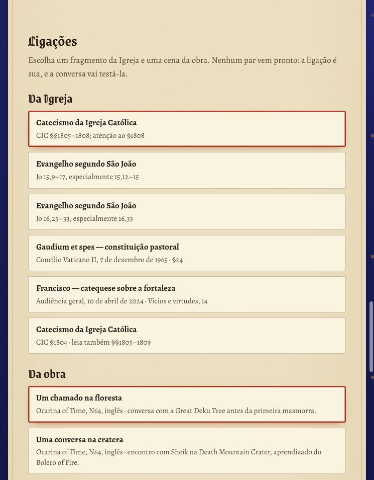
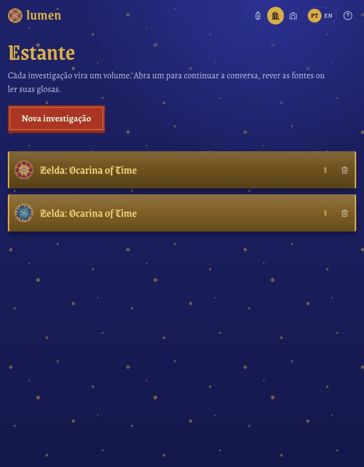
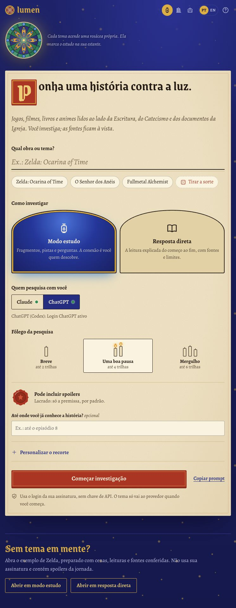
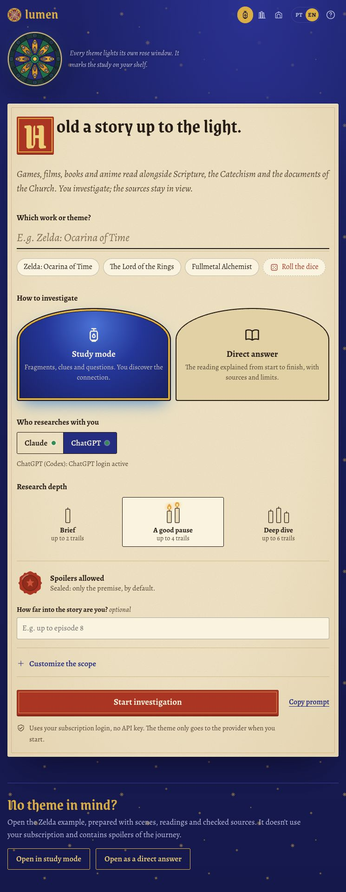
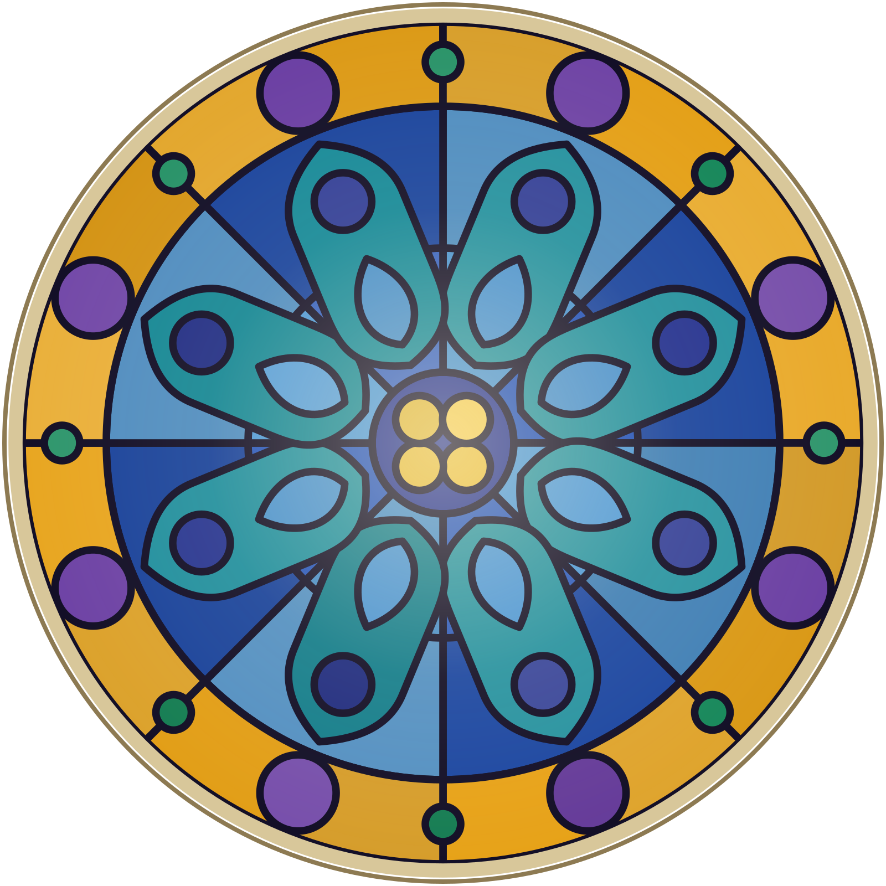
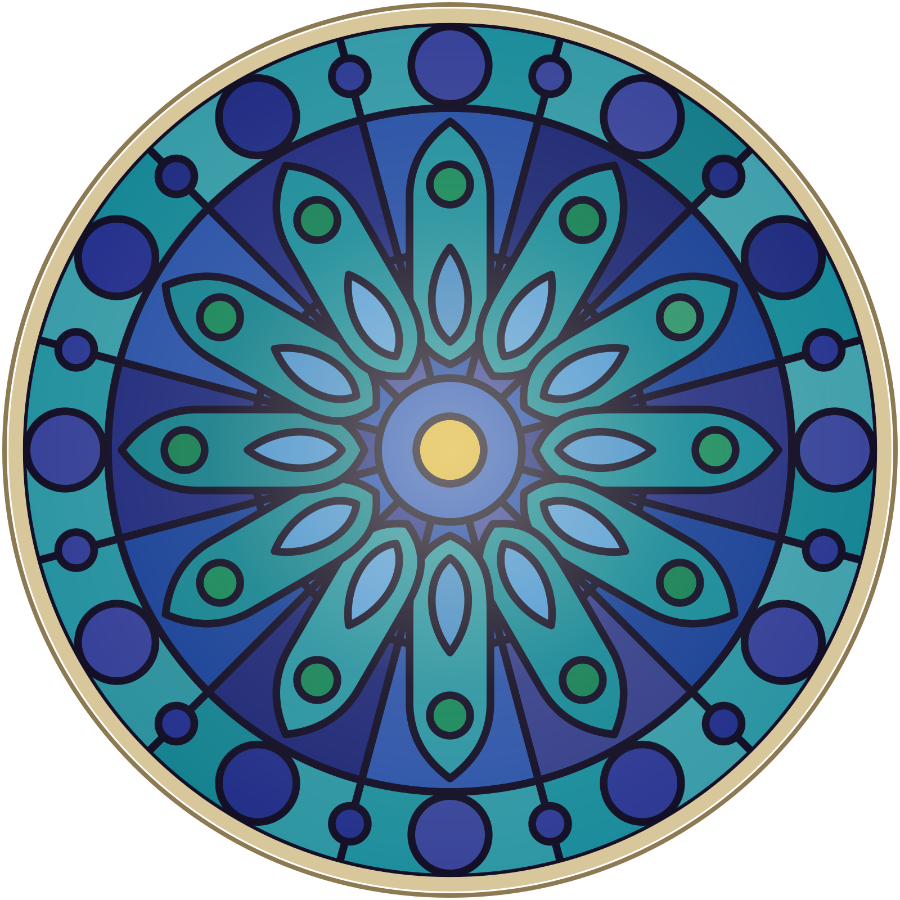
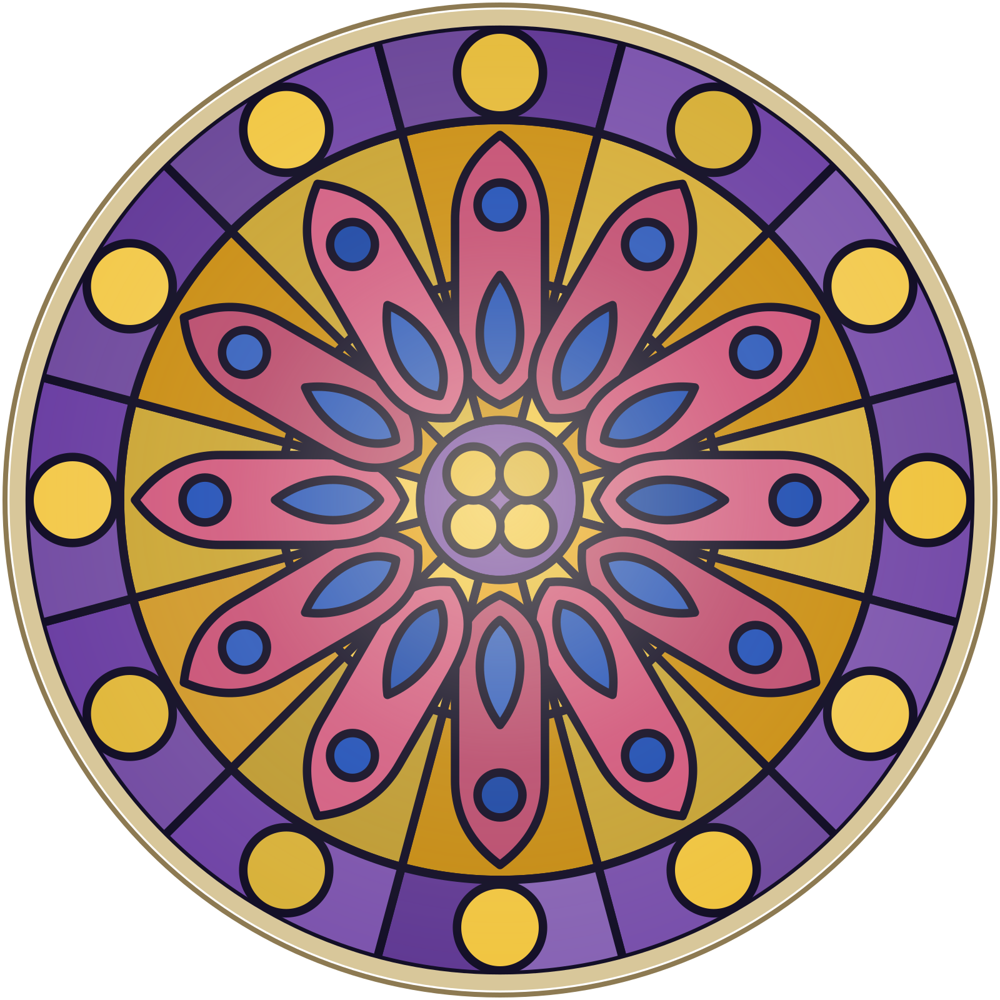
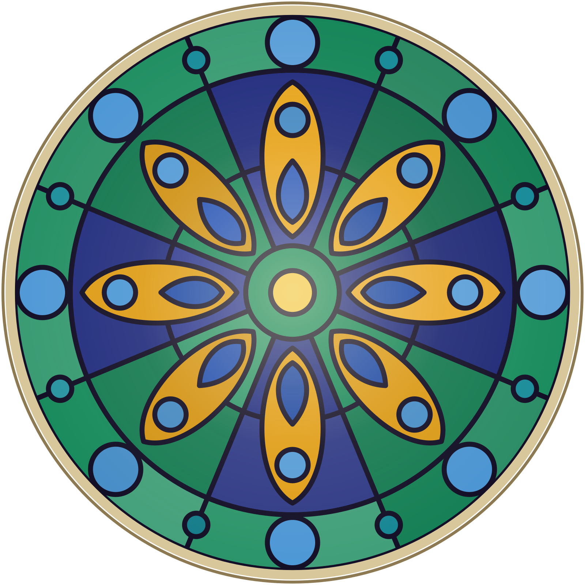

# Lumen — galeria / gallery

[Português](../../../README.md) · [English](../../../README.en.md)

11 capturas reais da interface, em português e inglês, usando somente os exemplos preparados de Zelda: Ocarina of Time. Nenhuma anotação pessoal foi incluída.

11 actual screenshots of the prepared *Zelda: Ocarina of Time* example, in Portuguese and English, plus four original SVG rose windows. No private notes. The scenes include spoilers.

## Português

| Cenas e diálogos | Escritura, Catecismo e documentos |
| --- | --- |
|  |  |

| Pistas e escolhas | Resposta direta |
| --- | --- |
|  |  |

| Ligações | Estante |
| --- | --- |
|  |  |

Tela inicial completa

## English

| Scenes and dialogue | Sacred art and Scripture |
| --- | --- |
|  |  |

### Clues and choices

Full home screen

Índice de arquivos / file index

- `01-inicio-pt.jpg` e `02-inicio-en.jpg`: início e configuração dos dois modos.
- `03-fragmentos-hyrule-pt.jpg` e `09-hyrule-en.jpg`: personagens, cenas e diálogos.
- `04-biblia-catecismo-pt.jpg`: Escritura, Catecismo e documentos da Igreja.
- `05-escolhas-pt.jpg` e `10-escolhas-en.jpg`: escolha de pistas para investigar.
- `06-ligacoes-pt.jpg`: seleção de fragmentos no quadro de ligações.
- `07-resposta-direta-pt.jpg`: exemplo no modo resposta direta.
- `08-estante-pt.jpg`: estante com os exemplos preparados.
- `11-arte-sacra-en.jpg`: abertura da investigação com arte sacra e Escritura.

As cenas dos exemplos contêm spoilers. A seleção no quadro de ligações ilustra a interação; a relação é uma hipótese a discutir.

## Rosáceas / rose windows

Quatro SVGs originais, gerados pelo próprio Lumen a partir dos temas Zelda, O Senhor dos Anéis, Fullmetal Alchemist e Lumen. São vetoriais e podem ser ampliados sem perder qualidade.

Vector designs generated by Lumen itself. Open an SVG to view or download the original; they scale without losing quality.

| Zelda | O Senhor dos Anéis | Fullmetal Alchemist | Lumen |
| --- | --- | --- | --- |
|  |  |  |  |

## Créditos / credits

As artes e capturas de Zelda pertencem à Nintendo. Os créditos aparecem nas capturas; consulte também [THIRD_PARTY.md](../../../THIRD_PARTY.md). A licença MIT do código não altera os direitos das imagens de terceiros.

The selected connection illustrates the interaction; it is a hypothesis to discuss. Zelda artwork and game screenshots belong to Nintendo. Credits accompany the images. The code's MIT license does not change third-party rights.

[Projeto / project](https://github.com/DiogoSabec/lumen)
